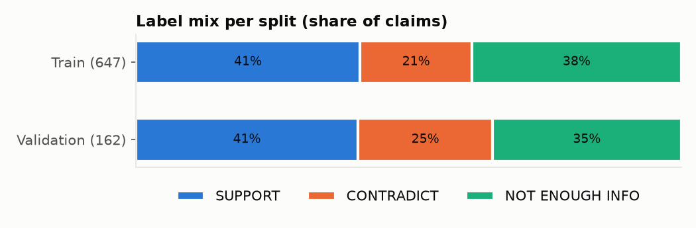
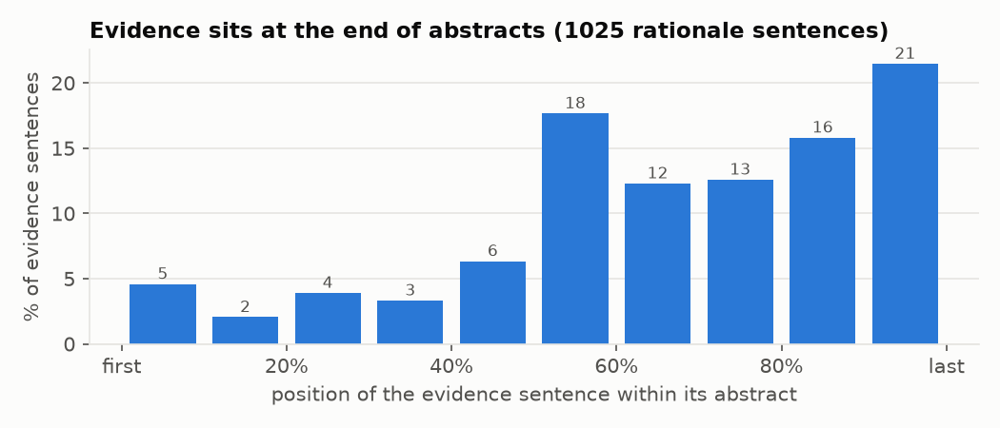
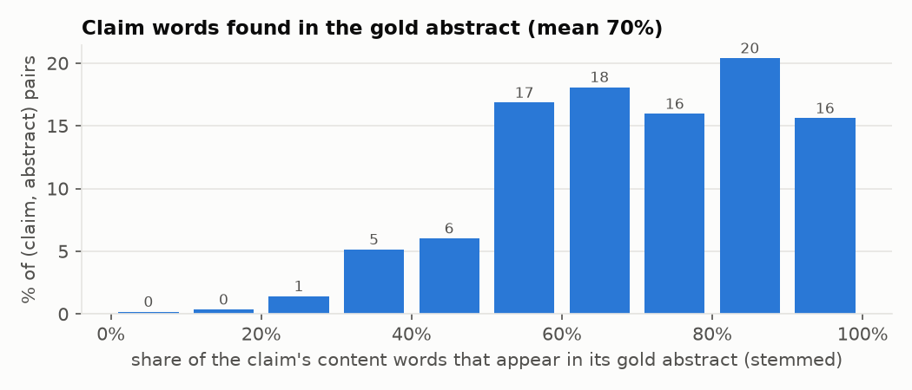
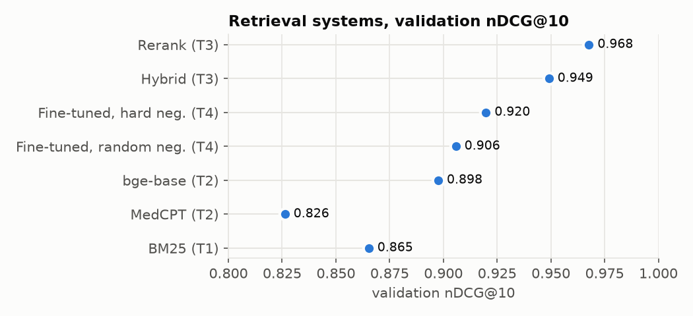
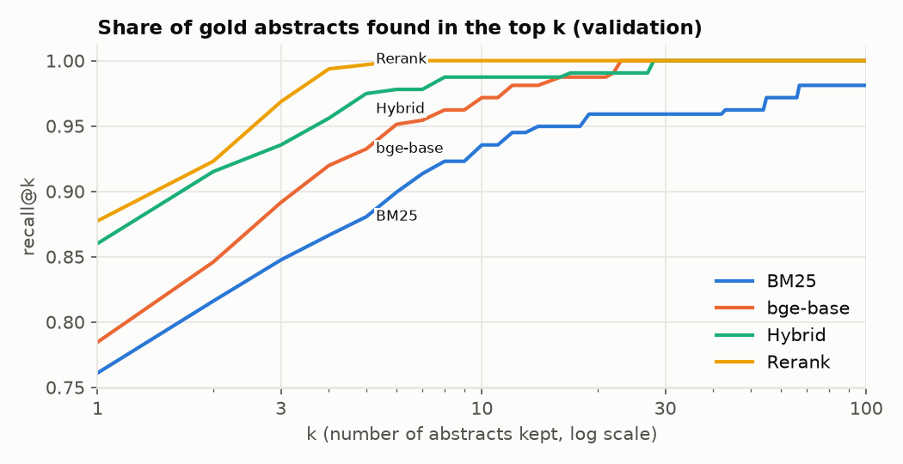
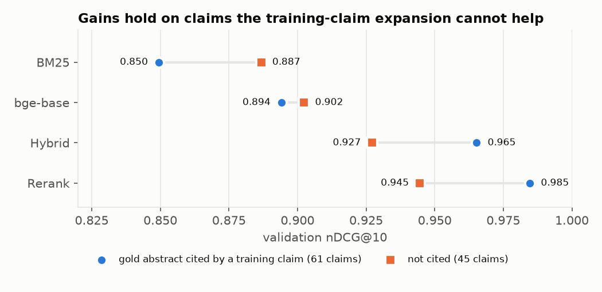
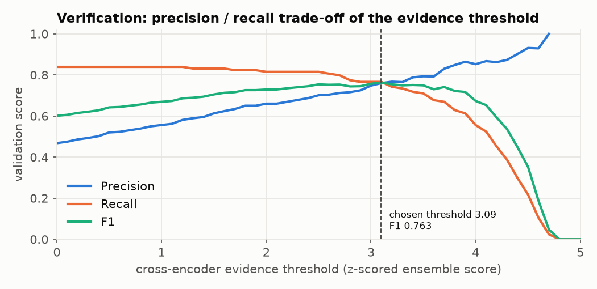
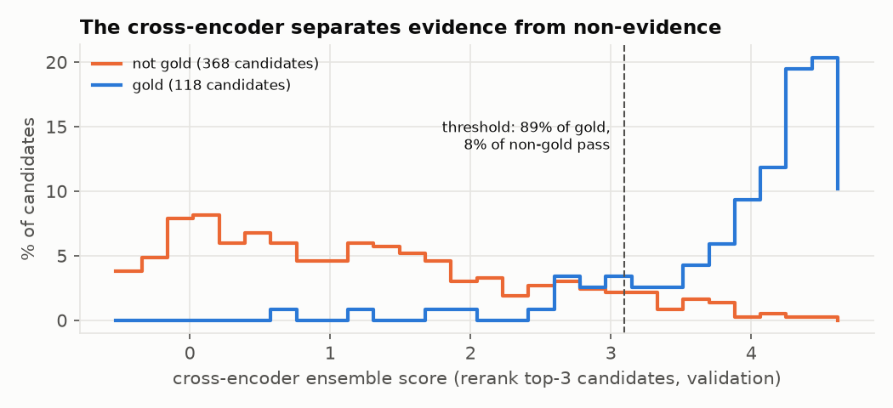
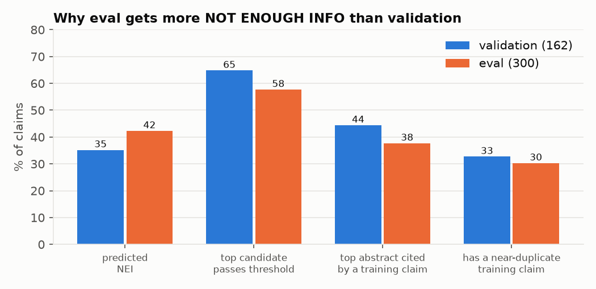

# Data analysis

A final, quantitative look at the data, the retrieval systems, the verifier, and the eval predictions.
All numbers come from `code/experiments/data_analysis.py` (saved in `docs/figures/analysis_numbers.json`); the figures
are drawn by `code/experiments/data_analysis_figures.py`. Retrieval and verification numbers are on the **validation**
split (162 claims, 106 with at least one gold abstract) unless stated otherwise.

Contents: [1 Dataset](#1-dataset) · [2 Retrieval](#2-retrieval) · [3 Verification](#3-verification) ·
[4 Eval predictions](#4-eval-predictions-vs-validation) · [5 Overfitting check](#5-overfitting-check) · [6 What it means](#6-what-it-means)

---

## 1. Dataset

### 1.1 Size and labels

| | Claims | SUPPORT | CONTRADICT | NOT ENOUGH INFO | Claim length (words, mean · p10–p90) |
|---|---|---|---|---|---|
| Train | 647 | 266 (41%) | 133 (21%) | 248 (38%) | 12.4 · 7–19 |
| Validation | 162 | 66 (41%) | 40 (25%) | 56 (35%) | 12.2 · 7–18 |
| Eval | 300 | hidden | hidden | hidden | 12.5 · 7–21 |

- No claim mixes SUPPORT and CONTRADICT evidence (0 in train and validation): **a claim's evidence always points one way.**
- Validation has slightly more CONTRADICT claims than train (25% vs 21%).
- Eval claims have the same length profile as the labelled splits.

**Evidence per claim** (claims with evidence): 1 abstract for 374 / 94 train / validation claims, 2 for 14 / 6,
3 for 6 / 6, 4 for 5 / 0. **Evidence sentences per abstract:** usually 1–2 (train: 210 × 1, 144 × 2, 58 × 3, 24 × 4,
4 × 5).

### 1.2 The corpus

| | Value |
|---|---|
| Abstracts | 5,183 |
| Words per abstract | mean 202, median 192, 90th percentile 295 |
| Sentences per abstract | mean 8.9 |
| Abstracts longer than ≈ 512 tokens (truncated by the models) | ≈ 2% |
| Abstracts cited as evidence by any train/validation claim | **365 (7%)** |
| … cited by two or more claims | 143 |
| Validation gold abstracts that are also gold for a training claim | **62 / 112** |

Only 7% of the corpus is ever evidence; the other 93% are distractors. And the abstracts that *are* evidence are often
evidence for several claims (sibling and negated claims written from the same paper), which is what the
training-claim expansion exploits.

### 1.3 Where the evidence sits inside an abstract

| Position of evidence sentence | First third | Middle third | Last third | Last sentence alone |
|---|---|---|---|---|
| Share of 1,025 rationale sentences | 10.6% | 36.4% | **53.0%** | 14.3% |

Evidence is concentrated in the second half — results and conclusions — and almost never in the opening background
sentences. The jump at the midpoint matches structured abstracts (BACKGROUND / METHODS / **RESULTS** / **CONCLUSIONS**).
*Implication:* methods sentences are where NLI produces false contradictions (Section 3.3 and `WALKTHROUGH.md` §9.3);
weighting later sentences higher, or a rationale-sentence selector, is a cheap untried improvement.

### 1.4 How much of the claim is in the gold abstract

| | Mean share of claim content words (stemmed, no stop words) found | Pairs below 50% |
|---|---|---|
| In the whole gold abstract | **70%** | 13% |
| In the rationale sentences only | 49% | — |
| SUPPORT pairs / CONTRADICT pairs | 71% / 69% | — |

Most claims reuse the abstract's own words, which is why plain BM25 is already strong (0.865). The 13% of pairs with
less than half the words in common are the paraphrase cases where dense models win (report Q1). Overlap is the same for
SUPPORT and CONTRADICT: **word overlap says nothing about direction**, which is why the label needs an NLI model.

### 1.5 Surface cues per label (train + validation)

| Label | Claims | Contain a negation word | Contain a number |
|---|---|---|---|
| SUPPORT | 332 | 6.0% | 41.6% |
| CONTRADICT | 173 | **16.2%** | 32.9% |
| NOT ENOUGH INFO | 304 | 10.2% | **48.4%** |

- CONTRADICT claims contain a negation word ("not", "no", "lack", …) almost 3× as often as SUPPORT claims: many are
  negated versions of a supported claim. A model could pick this up as a shortcut — another reason the label decision
  is made by NLI over the abstract's sentences, not from the claim alone.
- NOT ENOUGH INFO claims contain numbers most often: specific quantities ("90% of patients…") are easy to state and hard
  for any abstract to confirm exactly.

### 1.6 Near-duplicate claims across splits

| Claims with a training claim of word overlap (Jaccard) ≥ 0.6 | ≥ 0.8 | Mean best overlap |
|---|---|---|
| Train (vs other train claims) | 30.6% | 16.1% | 0.41 |
| Validation | 32.7% | 18.5% | 0.42 |
| Eval | **30.3%** | 17.0% | 0.40 |

About a third of every split has a near-twin in the training set, and **eval looks like validation** in this respect —
so the validation estimates of the twin-dependent components should transfer.

---

## 2. Retrieval

### 2.1 All systems

| System | nDCG@10 | MRR | Recall@1 | Recall@3 | Recall@10 | Recall@100 |
|---|---|---|---|---|---|---|
| BM25 (Task 1) | 0.865 | 0.850 | 0.761 | 0.847 | 0.936 | 0.981 |
| MedCPT (Task 2) | 0.826 | 0.791 | 0.651 | 0.825 | 0.953 | 1.000 |
| bge-base (Task 2) | 0.898 | 0.888 | 0.785 | 0.892 | 0.972 | 1.000 |
| Fine-tuned, random negatives (Task 4) | 0.906 | 0.900 | 0.788 | 0.926 | 0.962 | 0.991 |
| Fine-tuned, hard negatives (Task 4) | 0.920 | 0.914 | 0.818 | 0.925 | 0.965 | 1.000 |
| Hybrid (Task 3) | 0.949 | 0.942 | 0.860 | 0.936 | 0.987 | 1.000 |
| **Rerank (Task 3)** | **0.968** | **0.964** | **0.877** | **0.969** | **1.000** | 1.000 |

### 2.2 Recall at every depth

The rerank finds 97% of gold abstracts in its top 3 and all of them by rank 6; BM25 still misses 2% at rank 100.
This is what makes "verify only the top 3" safe for Task 5.

**Rank of the first gold abstract** (106 claims):

| System | Rank 1 | 2–3 | 4–10 | 11–100 | > 100 |
|---|---|---|---|---|---|
| BM25 | 86 | 6 | 8 | 4 | 2 |
| bge-base | 89 | 9 | 6 | 2 | 0 |
| MedCPT | 73 | 17 | 12 | 4 | 0 |
| Hybrid | 97 | 5 | 3 | 1 | 0 |
| **Rerank** | **100** | 4 | 2 | 0 | 0 |

Only two claims have their gold abstract outside the rerank's top 3 (both at rank 4): claim 34 ("A deficiency of
folate increases blood levels of homocysteine") and claim 463 ("Genomic aberrations of metastases provide information
for targeted therapy") — topics with many closely related papers in the corpus.

### 2.3 Is the gain just the training-claim trick?

| System | Gold abstract cited by a training claim (61 claims) | Not cited (45 claims) |
|---|---|---|
| BM25 | 0.850 | 0.887 |
| bge-base | 0.894 | 0.902 |
| Hybrid | 0.965 | 0.927 |
| Rerank | 0.985 | 0.945 |

**No.** On the 45 claims where the expansion cannot help at all, the pipeline still gains +0.058 over BM25
(0.887 → 0.945): most of that is genuine retrieval improvement from fusion and reranking. On the 61 claims where it can
help, the gain is larger (+0.135), which is where the expansion pays off. Interestingly, plain BM25 does *worse* on the
"cited" claims (0.850 vs 0.887): these are often negated/sibling claims whose wording differs from the abstract.

---

## 3. Verification

### 3.1 The threshold trade-off

| Evidence threshold | Precision | Recall | F1 |
|---|---|---|---|
| 0 (accept every candidate within 0.5 of the claim's best) | 0.468 | 0.839 | 0.601 |
| **3.09 (chosen on validation)** | **0.760** | **0.766** | **0.763** |
| 4.5 | 0.931 | 0.218 | 0.353 |

Recall barely moves until the threshold passes ≈ 2.5 while precision climbs steadily: low thresholds only add false
alarms. The chosen point sits where precision and recall cross. (Above ≈ 4.8 nothing is predicted; precision is then
undefined and not drawn.) Cross-validation inside validation gives the same F1 (0.763), so the threshold is not
overfit.

### 3.2 Why the cross-encoder can make that decision

| Candidates (rerank top 3, validation) | Count | Mean score | Pass the threshold |
|---|---|---|---|
| Gold abstracts | 118 | 3.99 | **89.0%** |
| Non-gold abstracts | 368 | 1.19 | **7.9%** |

The two distributions barely overlap. The remaining overlap region (scores ≈ 2.5–3.5) holds most of the errors:
gold abstracts that are only partial matches, and topically perfect non-evidence abstracts (e.g. claims 63/64 in
`ERROR_ANALYSIS.md`).

### 3.3 How good is the label decision on its own?

When the NLI ensemble is given the **correct** abstract, it chooses the right label **91.5%** of the time:

| Gold \ NLI | SUPPORT | CONTRADICT |
|---|---|---|
| SUPPORT (74) | **70** | 4 |
| CONTRADICT (44) | 6 | **38** |

Per-label triple scores of the submitted system: SUPPORT P 0.741 / R 0.750; CONTRADICT P 0.795 / R 0.795.
Label errors lean towards SUPPORT (6 vs 4): contradictions expressed as *magnitude* ("substantial weight loss",
"reduces the clearance rate") rather than negation are the hardest.

Claim-level exact accuracy by surface cue: with a negation word 13/18 (72%) vs 109/144 (76%) without; with a number
53/69 (77%) vs 69/93 (74%) without — no large gap: the earlier NLI-only systems struggled with negation, the combined
system much less.

---

## 4. Eval predictions vs validation

| | Validation (162) | Eval (300) |
|---|---|---|
| True NOT ENOUGH INFO share | 34.6% | hidden |
| **Predicted NOT ENOUGH INFO** | 35.2% | **42.3%** |
| Predicted SUPPORT / CONTRADICT | 40.7% / 23.5% | 40.3% / 16.7% |
| Claims with both labels predicted | 1 | 2 |
| Rows per claim | 0.77 | 0.64 |
| Top candidate passes the evidence threshold | 64.8% | 57.7% |
| Top abstract is cited by some training claim | 44.4% | 37.7% |
| Claim has a near-duplicate training claim | 32.7% | 30.3% |

- On validation the predicted NOT-ENOUGH-INFO rate (35.2%) matches the true rate (34.6%): **the system is calibrated
  where we can check it.**
- On eval it predicts NOT ENOUGH INFO more often (42%). The cause is not fewer near-duplicate claims (30% vs 33%), but
  that eval claims' top abstracts are **less often cited by a training claim** (38% vs 44%). The cross-encoder therefore
  scores them lower and fewer pass the threshold (58% vs 65%).
- Two readings are possible and cannot be separated without the eval labels: either eval genuinely has more NOT ENOUGH
  INFO claims, or the system under-predicts evidence on claims without training support. Given the double penalty of a
  wrong row (`WALKTHROUGH.md` §9), erring towards NOT ENOUGH INFO is the cheaper mistake.
- CONTRADICT is predicted less on eval (16.7% vs 23.5%), consistent with fewer negated twins being present.

**Agreement of the top-1 abstract between eval runs** (share of the 300 claims where both systems rank the same
abstract first):

| vs Rerank | BM25 | bge-base | MedCPT | FT hard | Hybrid |
|---|---|---|---|---|---|
| Same top-1 | 61.3% | 66.3% | 67.3% | 70.0% | 73.0% |

The rerank changes the first-ranked abstract for 27% of eval claims compared with the hybrid it starts from; on
validation it improved 13 claims and hurt 7 (`FINDINGS.md`), so most of those changes are expected to be corrections.

---

## 5. Overfitting check

Three kinds of overfitting were checked separately.

1. **Models memorising training claims** — every fine-tuned model was evaluated on validation after each epoch and the
   best epoch kept. bge-base with random negatives did overfit (0.906 → 0.891 after epoch 1) and was stopped at epoch 1;
   the cross-encoder was still improving at its last epoch (0.953 → 0.962 → 0.963).
2. **Leakage** — expansion, fine-tuning and hard negatives use training claims only; during cross-encoder training a
   claim never sees its own text (leave-one-out). Validation is used only to choose settings; eval labels are never seen.
3. **Overfitting to validation by choosing settings on it** — measured by re-choosing each setting on 4/5 of the
   validation claims and scoring the held-out 1/5 (`code/experiments/selection_bias_check.py`; retrieval averaged over
   20 random fold splits):

| Setting chosen on validation | Reported (in-sample) | Cross-validated estimate | Optimism |
|---|---|---|---|
| Hybrid weights (best of 112 configurations) | 0.949 | 0.942 ± 0.004 | +0.007 |
| Rerank depth k | 0.968 | 0.963 | +0.005 |
| Verification thresholds | F1 0.763 | 0.763 | 0.000 |

The selection optimism is below 0.01 nDCG and zero for verification — small next to the gains the design rests on
(expansion +0.063, p < 0.001; cross-encoder gate +0.13 F1 under cross-validation). Choices *between* whole experiments
were also made on validation; to limit that, an idea was adopted only if it improved under cross-validation or a
bootstrap test, and six ideas that did not were rejected. Separately, eval may score slightly below validation for a
non-overfitting reason: its top abstracts are less often cited by training claims (§4), and on such claims the rerank
scores 0.945 rather than 0.985.

## 6. What it means

1. **The data rewards using the training claims.** Only 7% of the corpus is ever evidence, 62 of 112 validation gold
   abstracts are shared with training claims, and a third of every split has a near-twin. This explains why expansion
   and fine-tuning help so much — and the "not cited" analysis (§2.3) shows the pipeline is strong without it too.
2. **Retrieval is essentially solved for this data; verification is not.** The rerank puts a gold abstract at rank 1
   for 100 / 106 claims and in the top 3 for all but 2. The remaining verification errors are about how many abstracts
   to return (`ERROR_ANALYSIS.md`), not finding them.
3. **Relevance and direction are different problems.** Word overlap and the cross-encoder separate evidence from
   non-evidence well (89% vs 8% pass); NLI gets the direction right 91.5% of the time once given the right abstract.
   Splitting the two decisions is what the final system does.
4. **Cheap untried ideas suggested by the data:** weight later abstract sentences (53% of evidence is in the last
   third), and a consistency rule that never mixes SUPPORT and CONTRADICT within a claim (affects 3 claims; the gold
   data never mixes them).
5. **The eval behaviour is explained, not alarming.** The higher NOT-ENOUGH-INFO rate on eval follows from less
   training-claim support for its top abstracts; on validation the same system is calibrated.
